# 苗家亲 产品操作手册

手册版本：0.1.0  |  产品版本：0.1.0  

## 目录

## 认识苗家亲，完成第一次体验

项目名称为“苗家亲 · Miao”。这是一款以贵州苗族文化与旅行体验为主题的网页/小程序演示产品。

### 适用范围与使用准备

本手册面向首次体验者、讲解人员和产品演示人员，项目版本 0.1.0。本产品计划以微信小程序形式上线，因备案审核等因素目前以网页域名形式提供给访问参考。以当次实际页面为准。无需注册或登录即可浏览本手册覆盖的功能。

用浏览器（chrome, edge, firefox等）打开产品地址，首次加载时保持网络连接。手机竖屏适合浏览内容；电脑可使用鼠标与键盘进行地图和手作操作。

| 入口 | 可以做什么 |
| --- | --- |
| 首页 | 认识三维向导纠笙，阅读开场故事并提问。 |
| 地图 | 漫游西江河谷文化场景，定位地标、换装、切换光影。 |
| 非遗 | 搜索 20+ 个文化故事，阅读技艺、地域差异及来源。 |
| 体验坊 | 进入六项小游戏，或选择苗绣、蜡染、银饰、玩偶手作等商业化项目。 |

### 第一次使用的推荐顺序

1. 打开产品，观看开屏视频；不想等待时点击“跳过”。
2. 在首页点击两次“继续”，再点击“去问问纠笙”。
3. 点击底部“非遗”，搜索“苗绣”，打开一篇故事。
4. 关闭故事，点击“地图”，体验一次地标定位。
5. 点击“体验坊”，选择“蜡染”完成一次作品，再返回。

> 主页面的内容区可以上下滚动，底部四个入口保持可见。小游戏使用独立页面，上方“返回体验坊”是主要退出入口。顶栏的小程序胶囊为视觉展示，仿造小程序界面UI。

## 和纠笙开始一段对话

入口：底部“首页”。三维形象与对话框共同组成首页体验。

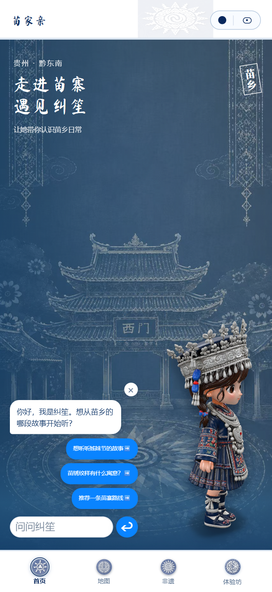

### 阅读开场故事

开屏结束后出现“蝴蝶妈妈的故事”。依次点击“继续”，最后点击“去问问纠笙”，即可打开对话。拖动三维人物可查看不同角度，自动旋转属于模型展示。

### 发送问题

初次打开时，可直接点选“想听听姊妹节的故事”“苗绣纹样有什么寓意？”或“推荐一条苗寨路线”。也可以在“问问纠笙”输入框中填写问题，点击发送箭头；电脑可按 Enter。

出现“纠笙正在想一想…”时，请等待当前回答完成。此时输入和推荐问题暂时不可用。回答会加入当前对话，较长内容可在对话区域内滚动阅读。

### 收起与继续

点击对话框右上角“×”可收起。回答后面板约 5 秒自动淡出；点击“问问纠笙”即可再次打开。点击输入框会暂停自动收起，便于继续输入。

### 如何理解回答

已配置Deepseek最新模型4.1 flash；请求失败时，页面会返回简短的本地预置回复。

## 看懂地图和视角工具

入口：底部“地图”。加载结束后显示“西江 · 河谷千户”三维场景。

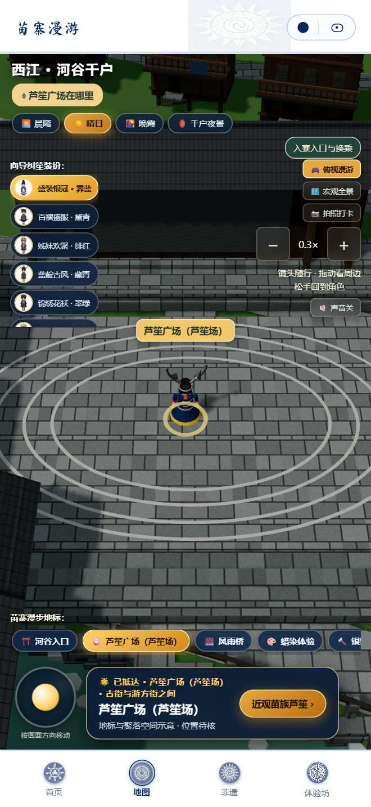

### 三个常用视角

“俯视漫游”：镜头跟随角色。按住场景拖动可看周边，松手后镜头回到角色。
“宏观全景”：拉远查看河谷、村寨和地标的整体关系。
“拍照打卡”：切换为近景构图，适合欣赏人物与场景。

### 拉近与拉远

俯视漫游时使用鼠标滚轮、双指缩放。本版范围为 0.1× 至 0.5×，默认 0.3×。

### 光影与声音

点击“晨曦”“晴日”“晚霞”“千户夜景”切换照明。点击“声音关”开启场景音效，再次点击“声音开”关闭。

模型加载时请等待。若出现加载错误，点击“重新加载”。如果画面持续黑屏或空白，先按第 22 页排查浏览器三维显示与网络条件。

## 定位地标并沿路步行

从“看到一个地点”到“真正抵达并打开内容”。定位与步行是两个不同操作。

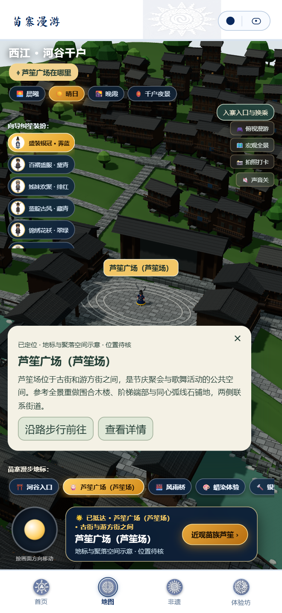

### 地标导航的标准步骤

1. 点击底部“苗寨漫步地标”横向列表中的地点；列表可左右滑动。也可点击场景中的地标文字。
2. 镜头会转向该地点，并出现“选中地标”卡片。
3. 点击“沿路步行前往”，角色开始沿场景道路移动。
4. 到达附近后，出现“已抵达”提示和对应体验按钮。
5. 点击体验按钮阅读内容或进入小游戏。

### 快速找到芦笙广场

点击上方“芦笙广场在哪里”，可直接定位“芦笙广场（芦笙场）”。选择“查看详情”可打开芦笙细节展示；选择“沿路步行前往”则开始步行。

### 不想继续前往

使用摇杆或方向键进行手动移动，可接管行走。卡片右上角“×”只用于关闭当前地标卡片；关闭后仍可重新选中地标。

| 设备 | 移动与互动 |
| --- | --- |
| 手机 / 鼠标 | 按住左下摇杆拖动；向上表示沿当前画面前方移动。点击可通行的地面也可发起步行。 |
| 电脑键盘 | W/A/S/D 或方向键移动；Shift 配合移动加速；空格切换跳舞状态；E 打开附近地点内容。 |

> 角色沿可通行道路活动。河面或不可通行区域可能无法直接到达，可换一个道路目标，或用地标卡片规划步行。键盘操作前，先关闭详情弹层，并确保焦点不在输入框或按钮上。

## 换装、看展和返回地图

地图把场景漫游与文化内容连在一起，不同地标会打开不同体验。

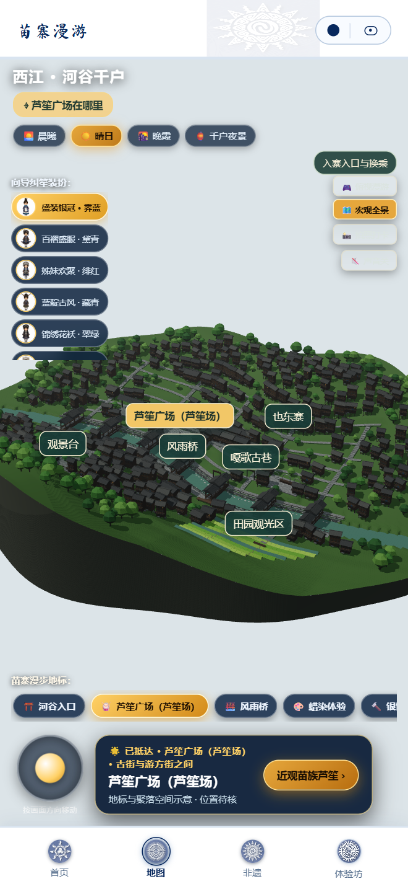

### 切换向导装扮

在“向导纠笙装扮”列表中点击一个形象。当前共有六套预设：盛装银冠·霁蓝、百褶盛服·黛青、姊妹欢聚·绯红、蓝靛古风·藏青、锦绣花袄·翠绿、银花飞歌·紫罗。切换影响本次地图中的向导展示。

### 地点内容各有入口

芦笙广场：打开芦笙三维细节，可“收起说明 / 展开说明”。
蜡染体验、银饰体验、长桌宴体验：在地图弹层内进入对应小游戏。
苗绣展览：阅读展览简介。
西江苗族博物馆：查看非遗全览条目。
观景台：抵达后的动作可切换观景视角。

### 结束当前内容

普通详情点击“返回苗寨漫游”或“漫游其他地标”；游戏弹层点击外层右上角“×（返回苗寨）”；芦笙细节点击其右上角“×”。

> 本地图用于文化体验。地标位置、建筑、街巷和路线仍含空间示意，后续可根据实际景区地图生成有对应关系的地图建模。也可提供实时班次或演出场次。

## 从搜索进入文化档案

入口：底部“非遗”。首页提供推荐故事、分类横向卡片和文化档案入口。

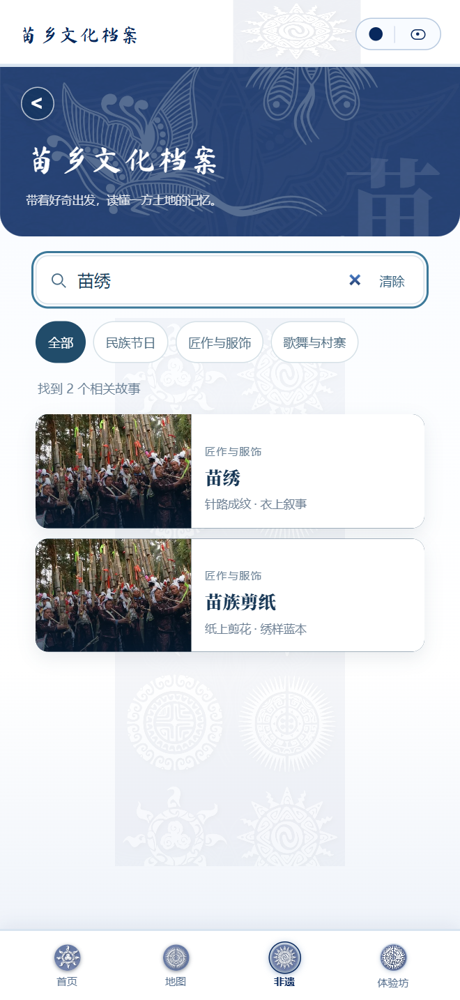

### 按主题浏览

点击首页推荐卡片，可直接阅读“姊妹节”。向下滚动，浏览“民族节日”“匠作与服饰”“歌舞与村寨”三组卡片。每组卡片可横向滑动；“查看全部”进入该分类列表。

### 按关键词搜索

在“搜索手艺、节日或地区”输入框中输入词语，例如“苗绣”“芦笙”“台江”或“丹寨”。

### 切换与清除条件

点击“打开苗乡文化档案”可查看全部 21 篇。（后续可根据景区需求增加完善内容）在档案页选择分类后，搜索只在该分类内生效。

## 阅读故事、跳转目录与查来源

打开故事后，在弹层正文区域上下滚动；底部导航暂时不可操作，先关闭故事再切换页面。

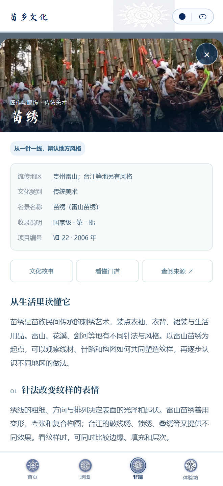

### 按阅读目标跳转

“文化故事”跳到生活背景。
“看懂门道”跳到“下次遇见，留意这些细节”。
“查阅来源 ↗”跳到本文末尾资料区，不会立即打开外部网站。

### 打开原始资料

在“资料与延伸阅读”中点击具体来源标题，才会打开外部资料页面。阅读后切回产品所在标签页继续。来源无法打开时，先保留标题，再稍后重试。

## 21 篇故事速查

使用下列名称作为搜索关键词，可以快速找到对应条目。

| 分类 | 故事名称 | 适合带着什么问题阅读 |
| --- | --- | --- |
| 民族节日 · 10 篇 | 姊妹节、鼓藏节、苗年、四月八、吃新节 | 节庆与团圆、敬祖、农事、地方记忆有什么关系？ |
| 民族节日 · 续 | 跳花节、芦笙节、赶秋节、招龙节、龙船节 | 不同地区怎样相会、歌舞或举行地方仪程？ |
| 匠作与服饰 · 6 篇 | 银饰锻制、苗族蜡染、苗族服饰 | 材料、工序与服饰层次可以如何观察？ |
| 匠作与服饰 · 续 | 苗绣、苗族剪纸、芦笙制作 | 绣样如何形成？纸样与针线、竹管与簧片有什么联系？ |
| 歌舞与村寨 · 5 篇 | 芦笙舞、苗族飞歌、苗族古歌 | 舞型、唱法与口传故事有什么区别？ |
| 歌舞与村寨 · 续 | 西江千户苗寨、吊脚楼 | 怎样从河流、建筑和生活空间理解村寨？ |

### 建议使用的三条阅读路线

路线 A / 第一次认识苗乡：姊妹节 → 苗族服饰 → 西江千户苗寨。
路线 B / 对手作感兴趣：苗族剪纸 → 苗绣 → 苗族蜡染 → 银饰锻制。
路线 C / 准备看歌舞：芦笙制作 → 芦笙舞 → 苗族飞歌 → 苗族古歌。

### 与其他模块联动

读完蜡染故事，可手动切换“体验坊”进入蜡染小游戏；读完银饰锻制，可进入列表中名为“炼铁”的游戏，其页面实际主题是“千锤成银”；读完西江千户苗寨，可切到“地图”观察地标。当前故事正文没有把这些路线自动串联成学习课程。

## 小游戏与手作定制（商业化）

入口：底部“体验坊”。页面上半部是六项小游戏，下半部是四类手作体验。

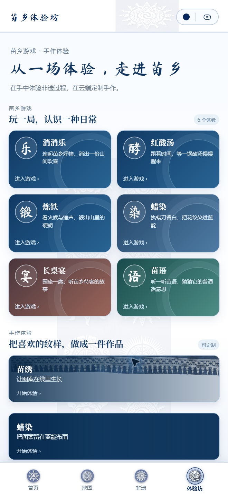

### 进入小游戏

点击游戏卡片或“进入游戏 ›”。消消乐、红酸汤、炼铁、蜡染、长桌宴和苗语分别提供不同的交互，不共享一套操作规则。

### 进入手作体验

继续向下滚动，在苗绣、蜡染、银饰、玩偶卡片中选择“开始体验”。流程通常为选风格、上传图片、生成预览、查看定制选项。

## 上传图片，生成手作预览

以下以“苗绣”为例。其他工艺的基本操作相同，风格名称和结果展示方式不同。

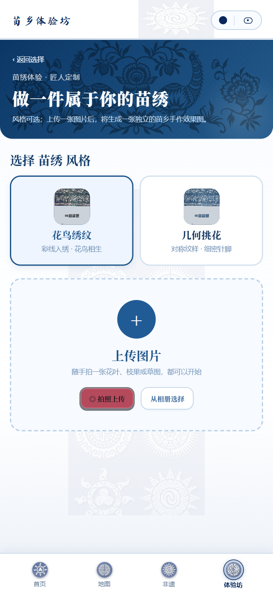

### 步骤 1 / 选择风格

进入苗绣后，点击“花鸟绣纹”或“几何挑花”（后续可根据商家需求进行样式调整）。被选中的卡片会高亮。切换风格会清除旧结果，需要重新生成。

### 步骤 2 / 上传图片

点击“上传图片”“拍照上传”或“从相册选择”，在设备文件选择界面中选一张图片。可以使用花叶、草图等清晰素材。上传成功后显示图片预览。

### 步骤 3 / 检查并生成

确认后点击“生成我的苗绣纹样”。生成期间按钮显示“正在生成苗绣效果…”，请等待结果区域出现。

风格速查：苗绣 / 花鸟绣纹、几何挑花；蜡染 / 蓝靛花鸟纹、冰纹留白；银饰 / 双龙纹、花鸟錾刻；玩偶 / 银冠盛装、百褶舞装。

## 查看结果与演示定制

结果出现后，可查看效果、重新制作，或打开产品选项。

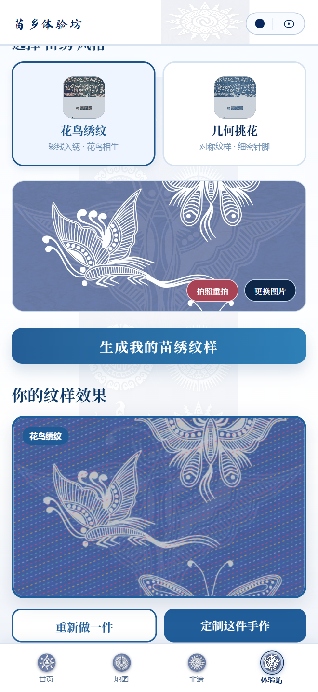

### 检查结果

苗绣、蜡染与银饰显示二维效果图。（后续可尝试3d模型）玩偶显示可拖动旋转的预设三维人物：按风格选择银冠或百褶造型。

### 重新制作

“重新做一件”会回到工艺选择并清空输入。仅想换图片时，回到上传区域点击“更换图片”；更换后重新生成。

### 查看定制选项

点击“定制这件手作”或“下单打印实体玩偶”，选择产品卡片，查看尺寸与“合计”金额。点击“提交定制 / 提交打印”会显示短暂的“下单成功”演示状态。

| 演示产品 | 页面显示规格 | 演示金额 |
| --- | --- | --- |
| 蜡染方巾 | 35×35cm | ¥68 |
| 纹样帆布袋 / 苗绣装饰画 | 38×42cm / 40×60cm | ¥158 / ¥198 |
| 3D 苗族人物玩偶 / 收藏版 | 15cm / 20cm · 全彩树脂 | ¥298 / ¥468 |

## 蜡染三维工坊

入口：体验坊 → 苗乡游戏 → 蜡染；或地图 → 蜡染体验。

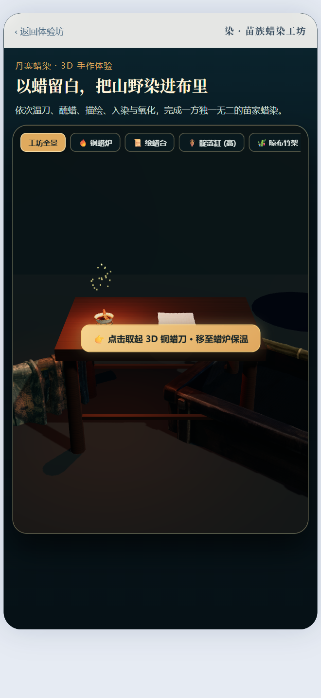

### 步骤 1 / 取起铜蜡刀

点击“点击取起 3D 铜蜡刀 · 移至蜡炉保温”。工坊上方还可切换“工坊全景”“铜蜡炉”“绘蜡台”“靛蓝缸（高）”“晾布竹架”，用于观察不同区域。

### 步骤 2 / 加热三次

在“第一步 · 温蜡与控量”面板点击“靠近炭火加热”，直到刀头温度达到“就绪（可蘸蜡）”。界面以 0/3 至 3/3 表示进度。

### 步骤 3 / 蘸蜡

点击“以刀角轻蘸熔化蜂蜡”，等待动作完成、蜡量达到“饱满”。点击“聚焦桌布 · 开始落蜡临摹”进入绘制。

### 步骤 4 / 描绘图案

选择纹样底稿，例如“蝴蝶妈妈”，也可选择“自由挥洒作画”。在画布中按住并拖动绘制，松手结束一笔。底稿用于临摹，成品留白以你实际画下的笔迹为准。

笔宽可选“细线（6px）”“中线（10px）”“封蜡（16px）”。“显现底稿 / 清晰底稿 / 隐藏底稿”切换辅助线显示；“撤销”删除上一笔；“清空重画”清空绘制。

### 步骤 5 / 达到封蜡条件

查看“落蜡笔数”和“工艺判定”。少于六笔时，下一步按钮提示还需多少笔。达到六笔后点击“封蜡完成 · 入靛蓝染缸”。

### 步骤 6 / 入染与氧化

等待染色进度完成，点击“出缸 · 挂上晾布竹架氧化”。再次等待氧化达到 100%，即可点击“展开成品 · 鉴赏我的杰作”。

## 红酸汤体验坊

入口：体验坊 → 红酸汤。这个体验通过分步动画展示制作过程。

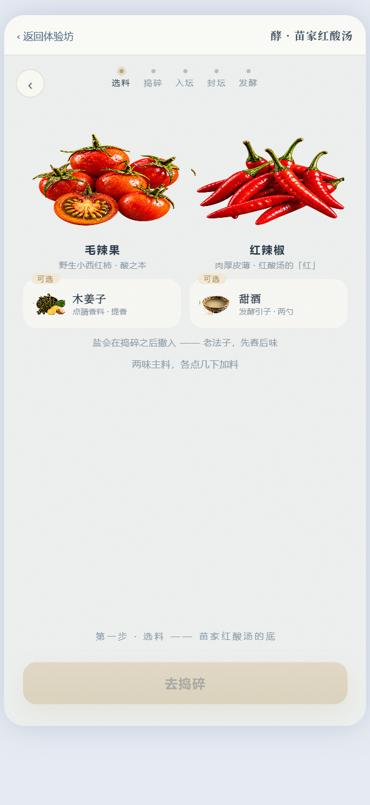

### 步骤 1 / 开始与选料

点击“开始做一坛”。点击毛辣果和红辣椒添加数量，角标中的“−”可减少用量。两种主料至少各一份后，“去捣碎”才可点击。

木姜子和甜酒是可选配料，点击切换是否加入。确认后点击“去捣碎”。

### 步骤 2 / 捣碎

连续点击石臼或“捣一下”。进度逐渐增加，原料从整颗变为细碎果浆。达到 100% 后，等待调味按钮出现。

### 步骤 3 / 加入调味

按按钮提示依次完成“撒盐”以及已选中的甜酒、木姜子用量。按钮后的数字表示剩余点击次数；全部用完后进入搅拌阶段。

### 步骤 4 / 按住搅拌

按住“按住搅拌”直到进度完成。松手会暂停，可再次按住继续。显示“拌匀了 ✓ 可以装坛”后，点击“装坛 →”。

### 步骤 5 / 分三次装坛

点击“装坛”，等动画结束后再点击。累计三次后显示“装满了”。可以轻点坛身查看震出气泡的动画，再点击“封坛 →”。

### 步骤 6 / 封坛

点击“盖上坛盖”。等待封坛和水封说明完成，出现“交给时间 →”后点击进入发酵阶段。

### 步骤 7 / 查看发酵阶段

拖动下方时间轴，或点击时间轴上的不同位置，观察汤色、气泡、酸度显示与阶段说明。需要主动推动时间轴；仅停留等待不会自动推进到最终阶段。

### 步骤 8 / 开坛看结果

时间轴达到成熟阶段后，“开坛”按钮出现。点击并等待开坛动画，再点击“看看酿出了什么 →”，查看本次结果与图鉴。

## 炼铁工坊

入口：体验坊中名称为“炼铁”的卡片，打开后主题为“锻 · 千锤成银”；地图的“银饰体验”也能进入。

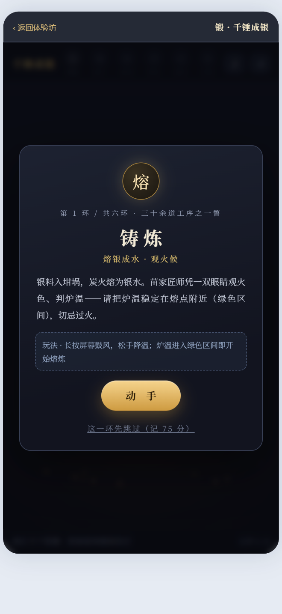

### 开始一轮体验

封面点击“开始锻制”。每道工序先阅读“玩法”，点击“动 手”开始。完成后显示本环结果，点击“下一道工序”继续。

### 步骤 1 / 铸炼

按住游戏区域鼓风升温，松手降温。观察炉温，尽量使它保持在绿色区间，等待熔炼进度完成。

### 步骤 2 / 捶打

观察摆动的指针，进入亮区时点击落锤；电脑也可以按空格。共八锤，重点是判断时机。

### 步骤 3 / 錾刻

按住刀尖，沿蓝色走廊从“始”拖到“终”。稍微偏离会吸附到刀路，持续完成描线。

### 步骤 4 / 焊接

按住银饰接点加热，观察温度环，环满后自动焊牢，再处理下一处接点。

### 步骤 5 / 编结
把托盘里的银件拖到项圈对应的虚线轮廓上，逐一完成拼装。

### 步骤 6 / 洗涤
按住银饰来回擦拭，直到光泽槽填满。完成后点击“淬火成器”查看总结果。

### 重玩与辅助 
结果页点击“再锻一件”。介绍页可选“这一环先跳过（记 75 分）”；跳过得到的是辅助分数。

## 长桌宴游览

入口：体验坊 → 长桌宴；或地图 → 长桌宴体验。此模块是可交互数字展览，没有通关分数。

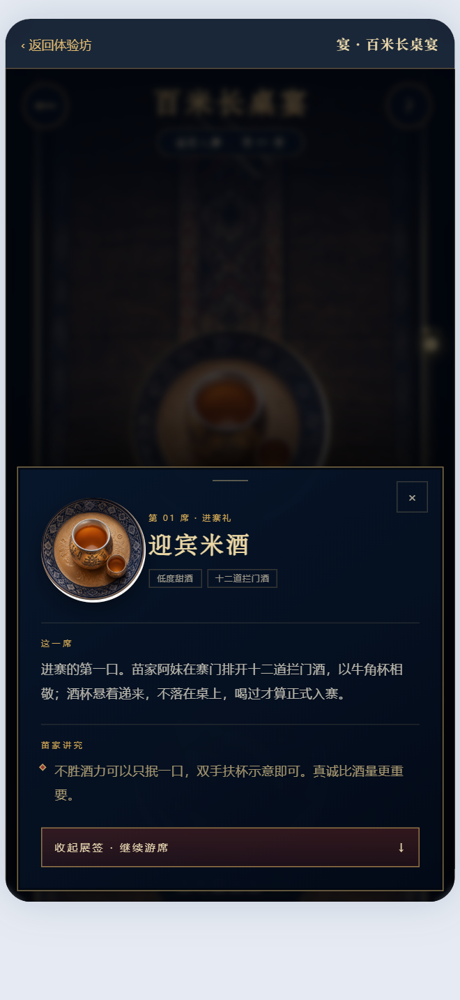

### 入宴与移动

封面点击“入宴门”。在长桌区域上下滑动，电脑可用滚轮或按住拖动，从寨门逐步走向篝火。顶部位置和侧边 01/12 进度会随浏览变化。

### 打开一道风物

轻触桌上的器皿或对应图像，弹出展签。查看名称、主题标签、“这一席”和“苗家讲究”；展签内容较长时在卡片内滚动。

### 关闭与继续游席

点击展签右上角“×”、遮罩区域，或“收起展签 · 继续游席”。电脑可按 Esc 关闭。继续上下滑动到下一席。

### 导览与离席

“导览”展开游席操作说明。“离席”返回本体验序厅。要退出到体验坊，请点击外层“返回体验坊”，而不是只点击“离席”。

### 十二席名称

迎宾米酒 → 苗岭酸汤鱼 → 白切跑山鸡 → 烟熏腊味拼 → 折耳根拌腊肉 → 苗王鱼酱 → 米豆腐 → 五彩糯米饭 → 手打糍粑 → 自酿米酒 → 酸萝卜 → 篝火歌堂。

## 苗家消消乐

入口：体验坊 → 消消乐。每局目标是用有限步数收集指定数量的好物。

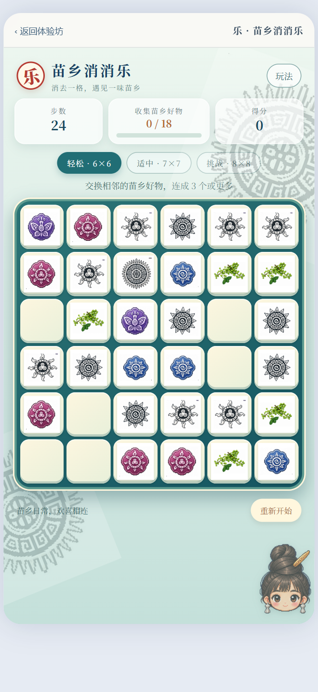

### 选择难度

初次打开先在说明卡中选择难度。开始后也可点击棋盘上方的难度按钮，但会重新开局。

### 进行一次交换

1. 点击一枚好物选中它。
2. 点击它上、下、左、右相邻的另一枚。
3. 交换后，横向或纵向连续三个及以上同类即可消除。
4. 等待下落和连消结束，再进行下一步。

### 胜负与重玩

收集数量达到目标即成功；步数用尽且目标未达成则结束。点击“再玩一局 / 重新挑战”重开；底部“重新开始”会直接重置当前局。

| 难度 | 棋盘 | 步数 | 收集目标 |
| --- | --- | --- | --- |
| 轻松游玩 | 6×6 | 24 | 18 份 |
| 适中挑战 | 7×7 | 20 | 24 份 |
| 高手试炼 | 8×8 | 18 | 32 份 |

得分与目标是两项指标：每轮消除按好物数量累计分数，连消会放大得分；是否完成主要看收集数量。点击“玩法”可以重看说明，重新选择难度会重开，不能用于暂停后无损续玩。

## 苗语传承

入口：体验坊 → 苗语。界面标记“东部方言”，分为入门、进阶和挑战。

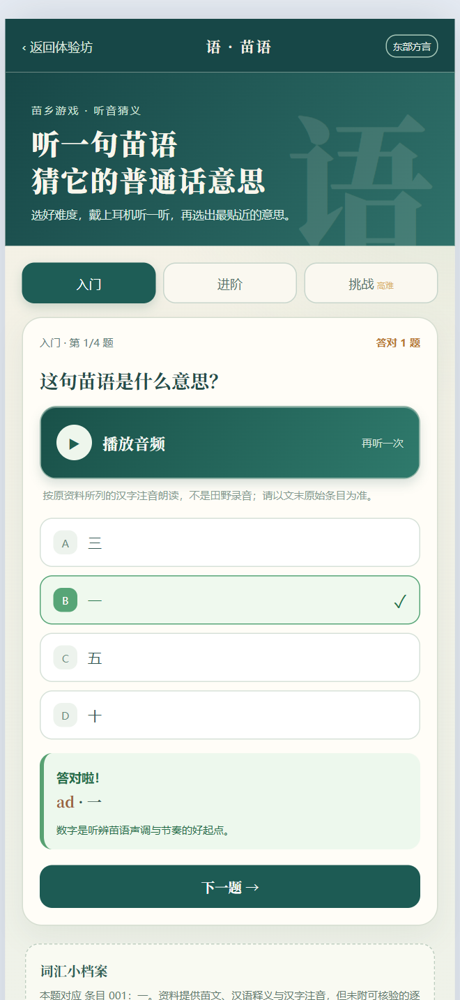

### 步骤 1 / 选择难度

“入门”练习数字；“进阶”练习常用称谓与感谢；“挑战”练习简短句子。每组四题。切换难度会把题目与答对数量重置。

### 步骤 2 / 播放

点击“播放音频”，需要时可反复播放。设备会按资料中的汉字注音合成朗读；没有声音时先检查设备音量与浏览器语音能力。

### 步骤 3 / 作答

从四个选项中选择最贴近的意思。每题只能选择一次，随后正确答案标记“✓”，选错项标记“×”，并显示“答对啦！”或“差一点！”及解释。

### 步骤 4 / 继续

未作答时“下一题”不可点击。作答后点击“下一题 →”；第四题完成后点击“再来一轮”，题序与分数归零。选项顺序可能变化，请按内容判断。

### 到哪里查词汇依据

下方“词汇小档案”给出当前题目所对应的条目编号。点击详细原始资料链接，可打开《贵州民族语言学习简本·苗语（东部方言）》相关资料。返回后继续下一题。

## 常见问题

| 现象 | 可能原因与处理 |
| --- | --- |
| 打开 /map 或 /heritage 却回到首页 | 普通页面冷启动会先播放开屏；跳过或播完后导航到首页。再点击底部对应入口。 |
| 地图按钮灰色，暂时不能定位 | 模型仍在加载。等待加载结束；出现错误提示后使用“重新加载”。 |
| 地图或人物黑屏、空白、卡顿 | 检查网络与三维资源是否加载；换用支持 WebGL 的浏览器并启用硬件加速。关闭其他大型三维页面后重试。仍异常时记录浏览器版本与现象。 |
| 人物没朝预想方向走 | 摇杆向上以当前画面前方为准。先回到“俯视漫游”，在道路上试走；跨河应沿桥梁通道。 |
| 非遗列表为空 | 分类和关键词共同筛选。点击“清除”，再选“全部”；或点击“浏览全部故事”。 |
| 底部导航点不了 | 故事详情打开时会锁定主界面。先点右上角“×”或按 Esc 关闭。 |
| 纠笙回复很短或反复相似 | 可能正在使用本地预置回答。换一个明确的问题；在线服务状态需要由维护人员检查。 |
| 没有生成按钮 / 结果消失 | 先上传一张图片。更换图片、切换风格或重新制作会清空旧结果，需要再次生成。 |
| 定制提交被底部导航挡住 | 本次在 440×956 窗口观察到。电脑可用 Tab 聚焦“提交定制”后按 Enter；手机无法完成时退出该演示，不代表支付失败。 |
| 蜡染不能进入下一步 | 检查温度、蜡量、至少六笔描绘，以及浸染/氧化是否完成。刮蜡后需再次蘸蜡才能看到落笔入口。 |
| 红酸汤一直不能开坛 | 两种主料必须都有，调味计数要清零；搅拌需长按；发酵时间轴需要手动拖到成熟阶段。 |
| 苗语没有声音 | 先点击播放并检查音量、静音状态。更换支持系统语音合成的浏览器；无声时仍可按文字作答并查资料。 |

## 访问路径与嵌入页面说明

地址均为产品站点内路径。正式使用时在部署方提供的域名后添加对应路径。

| 常用页面 | 路径 |
| --- | --- |
| 首页 / 地图 | 首页：/；地图：/map |
| 非遗 / 兼容入口 | /heritage / /culture |
| 体验坊 | /workshop |
| 六项小游戏 | 消消乐：/games/xiaoxiaole 红酸汤：/games/hongsuantang 千锤成银：/games/silver 蜡染：/games/wax-dye 长桌宴：/games/miao-feast 苗语：/games/miao-language |

### 嵌入页面与普通浏览页的区别

路径以 /miniapp/ 开头的是供宿主容器使用的嵌入页面，可能没有普通页面的顶栏、底部四个入口或返回按钮。它们是网页嵌入表面（此功能将由于微信小程序的网页访问）

| 嵌入表面 | 路径 |
| --- | --- |
| 首页 / 地图 / 人物 | /miniapp/home · /miniapp/map · /miniapp/avatar |
| 小游戏 | /miniapp/games/hongsuantang · /miniapp/games/miao-feast · /miniapp/games/silver · /miniapp/games/xiaoxiaole · /miniapp/games/miao-language |
| 蜡染小游戏 | /miniapp/games/batik（与普通路径的 wax-dye 不同） |
