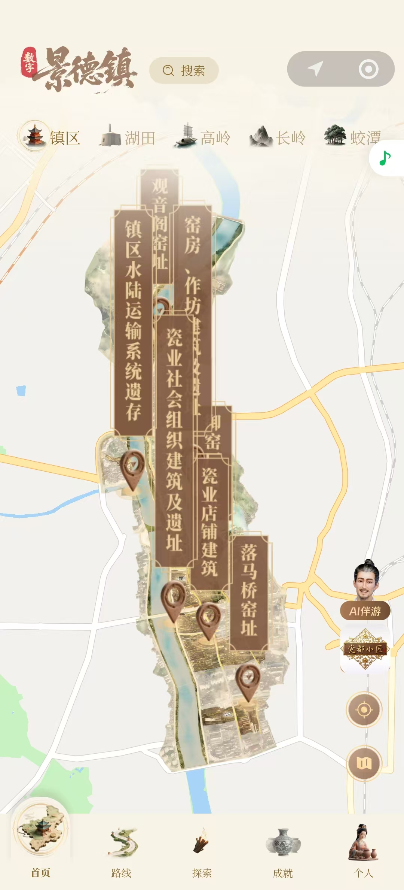
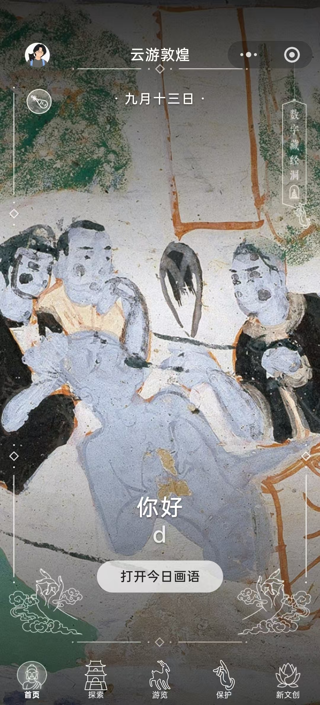
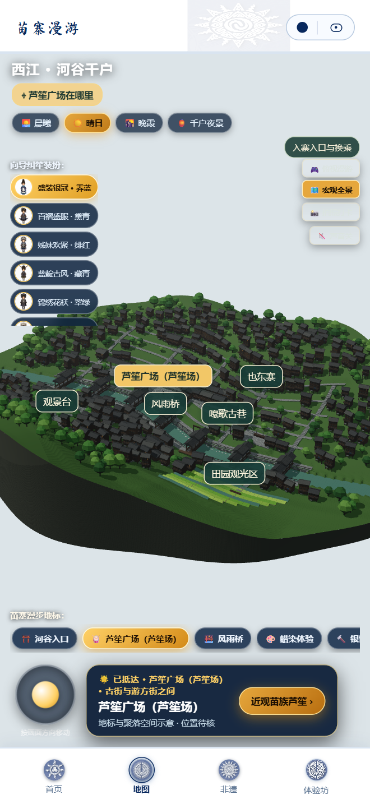
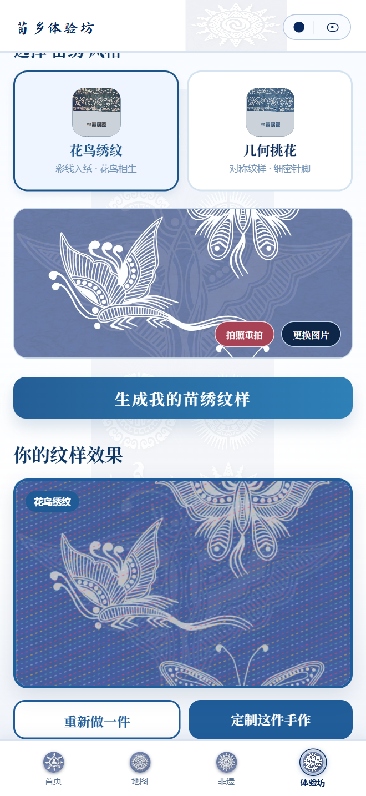

# 苗家亲 产品说明书

## 产品概述

苗家亲以贵州苗族文化为核心，将数字向导、三维苗寨、文化故事与互动手作结合，为游客提供认识苗乡、参与文化体验和探索文创产品的数字入口。

项目以景德镇、故宫、敦煌等文化地标的数字化表达为参照，致力于打造具有苗族文化辨识度的数字文旅品牌。

当前产品以网页演示，目标形态为微信小程序，已包含四个主入口、21 篇文化故事、六项互动体验、四类手作体验和六款三维人物形象。

### 产品价值

**容易走近文化。** 通过向导纠笙、推荐话题和主题故事，让初次接触者从节日、纹样或村寨生活中的一个问题开始探索。

**能够参与体验。** 将技艺、饮食和语言内容转化为工坊、展览与游戏，让使用者观察过程、尝试制作并获得反馈。

**连接文创表达。** 将文化背景与风格预览结合，使使用者在理解工艺之后，探索适合自己的纹样与商品载体。

### 适用场景

| 面向对象 | 应用场景 | 合作价值 |
| --- | --- | --- |
| 游客与文化兴趣人群 | 行前认识苗乡，游览期间延伸阅读，行后参与手作体验 | 围绕个人兴趣持续探索文化。 |
| 景区与文旅运营方 | 景区展介、地标导览、节庆活动 | 将本地文化组织为可展示、可参与的数字体验。 |
| 文化场馆与研学组织 | 纹样、歌舞、宴席等主题讲解 | 结合故事与互动辅助文化教育。 |
| 文创商家与手作机构 | 工艺介绍、风格展示、商品预览 | 为实体手作与文创产品建立体验入口。 |

## 数字文旅参考案例

数字景德镇、云上中轴与云游敦煌展示了文化地标的不同数字表达，为苗家亲的场景导览、角色陪伴和文化内容呈现提供参考。

### 数字景德镇

地图串联窑址、作坊等文化地点，结合 AI 伴游入口，呈现城市文化探索场景。

### 云上中轴

截图标题为“AI 数字中轴”，以中轴线全景和人物向导呈现空间导览。

### 云游敦煌

以壁画构成视觉主体，将探索、游览、保护与新文创组织为文化体验入口。

以上为参考案例界面，苗家亲将围绕苗族村寨、节俗和技艺建立自身内容与品牌表达。

## 数字导览与文化内容

产品由“首页、地图、非遗、体验坊”四个入口组织，形成从认识文化到参与创作的体验路径。

**认识纠笙 → 走进苗寨 → 阅读故事 → 参与体验 → 手作预览**

### 数字向导纠笙

纠笙以三维人物、开场故事和文字问答，引导使用者了解节日、纹样与旅行主题。六款人物形象展示不同服饰造型，为产品建立统一的视觉识别。

### 三维苗寨漫游

“西江 · 河谷千户”场景提供漫游、全景观察、人物装扮与光影变化。芦笙广场、苗绣展览、博物馆及工艺体验地标，将空间浏览与文化内容联系起来。

### 苗乡文化档案

21 篇故事分为民族节日、匠作与服饰、歌舞与村寨三类，涵盖姊妹节、苗绣、蜡染、芦笙、古歌和吊脚楼等主题。故事结合生活背景、观察细节与资料来源，支持搜索和延伸阅读。

### 主题体验的衔接

以蜡染为例，使用者可先了解文化背景，再通过地图地标进入工坊，最后尝试手作预览。地图已连接部分互动体验，其余内容可通过主入口继续探索；合作方也可据此组织主题讲解。

## 互动体验与文创手作

六项体验依据文化内容采用不同形式，覆盖工艺、饮食、宴席、休闲与语言。

| 体验主题 | 数字形式 | 体验重点 |
| --- | --- | --- |
| 蜡染 | 三维工坊、纹样绘制与染色 | 观察落蜡、留白与染色的关系。 |
| 银饰锻制 | 铸炼、捶打、錾刻等工序互动 | 认识制作环节及其衔接。 |
| 红酸汤 | 选料至发酵的分步动画 | 感受材料、工序与时间变化。 |
| 长桌宴 | 十二席数字展览与风物展签 | 了解饮食与待客文化。 |
| 苗家消消乐 | 融入文化好物的休闲玩法 | 提供轻量参与入口。 |
| 苗语传承 | 词汇、句子与听读问答 | 激发语言兴趣并查阅词汇依据。 |

### 从文化兴趣到作品表达

苗绣、蜡染、银饰和玩偶四类手作支持风格选择与效果展示。使用者上传图片参与预览，了解纹样与商品载体的组合方式。

苗绣、蜡染与银饰呈现二维效果，玩偶采用预设三维人物。演示商品包括方巾、帆布袋、装饰画和人物玩偶。

### 文创合作空间

商家可结合自身工艺、样式和商品，开展文化讲解、作品预览与线下体验活动。正式定制业务需进一步接入订单、支付及实体交付。

## 客户合作与商业化

苗家亲可围绕项目建设、内容服务和文创业务探索商业化。以下为拟议合作方式，交付范围与收费标准由具体项目确定。

| 合作方向 | 合作内容 | 商业形式 |
| --- | --- | --- |
| 景区数字体验 | 适配村寨场景、文化地标与代表性体验 | 按建设范围收取项目费用。 |
| 文化主题内容 | 制作节庆、技艺、风物专题及配套体验 | 内容制作费或周期更新服务费。 |
| 文创展示与定制 | 适配风格素材、商品载体和预览流程 | 功能服务费；接入真实交易后可另议销售分成。 |
| 节庆活动 | 组合角色、故事与互动内容 | 按活动范围收取制作与服务费用。 |

### 试点切入

从一个场景、一组内容和一项体验开始，例如“苗寨漫游与蜡染工坊”或“苗绣故事与商品预览”。先确定受众与交付范围，再根据反馈扩展。

### 合作分工

合作方提供本地资料、场景素材、内容审校及实体服务资源；产品侧负责内容组织、场景适配和交互制作。正式研学需共同确定教学目标，实体定制需明确生产、配送与售后安排。

### 价值验证

试点可观察内容阅读、体验完成、用户反馈、合作咨询与文创兴趣，评估客户需求和交付投入。相关指标需在试点中设计采集，尚不代表已取得的运营成果。

## 发展方向与版本范围

### 下一阶段重点

将现有演示能力落到具体客户场景，验证参与意愿、付费需求与交付成本，再逐步扩展至更多苗族文化主题和合作地点。

| 阶段 | 核心工作 | 验证重点 |
| --- | --- | --- |
| 合作试点 | 适配景区或文创主题 | 客户需求、用户反馈与工作量。 |
| 项目落地 | 完善场景与内容，推进微信小程序形态 | 交付范围、上线条件与运营分工。 |
| 商业验证 | 开展项目建设、内容服务或文创收费合作 | 付费意愿、成本与持续服务价值。 |
| 逐步扩展 | 复用成熟的内容组织与互动制作方法 | 适配效率、维护投入与内容质量。 |

### 可持续积累

资源投入可优先用于文化内容审校、三维场景与人物、交互制作、产品稳定性和合作试点。随项目推进，积累经过审校的故事、地域素材与制作方法，形成持续交付的基础。经营效果与规模潜力需以实际合作结果验证。

### 当前版本范围

V0.1.0 为网页演示版本。地图包含空间示意，后续可按真实景区资料适配；手作定制展示预览与提交流程，真实交易及交付需另行接入；玩偶使用预设模型，苗语声音采用注音合成。

详细入口、操作步骤与使用问题，参见[《苗家亲 产品操作手册 V0.1.0》](苗家亲_产品操作手册_V0.1.0.md)。

<!-- 内容依据：苗家亲_产品操作手册_V0.1.0.md 及 tmp/pdfs/ 中的素材与记录。排版以操作手册 V0.1.0 PDF 的样式为准。Markdown 为说明书编辑源。 -->
